<h1 align="center">FPGA-Based Vending Machine</h1>

<p align="center">
  A five-product vending machine built as a finite state machine in Verilog HDL and run on the Digilent Basys3 (Xilinx Artix-7) FPGA with a PMOD 4x4 keypad.
</p>

<p align="center">
  
  
  
  <a href="https://github.com/SujithPG-coder/fpga-vending-machine-verilog/actions/workflows/simulation.yml"></a>
  
</p>

<p align="center">
  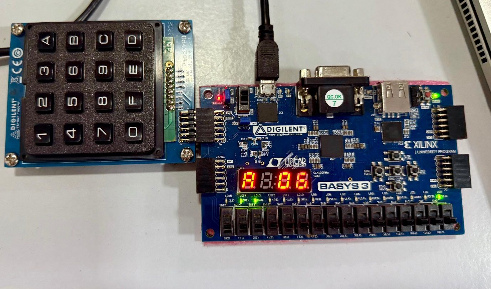
</p>

---

## Overview

Many vending machines only work with exact change, can't cancel a purchase after money goes in, and don't say when an item is sold out. This project fixes all three. It is a complete digital vending machine in hardware: a 7-state FSM that takes coins from a keypad, checks stock, dispenses the product, gives back change, handles refunds, and shows everything on the board's 7-segment display and LEDs.

## Features

- **5 products (A–E)**, each with its own price and stock count
- **Coins accepted:** $1, $2 and $5
- **Change:** automatically returns any extra money
- **Cancel / refund:** gives back the inserted money at any time before dispensing
- **Out-of-stock alert:** a sold-out product goes straight to the *No Stock* state
- **Live display:** product, price, remaining balance, change and refund on a multiplexed 4-digit 7-segment display
- **Status LEDs:** FSM state, money inserted and dispense signal

| Product | Price | Initial Stock |
|:------:|:-----:|:-------------:|
| A | $6  | 10 |
| B | $5  | 4  |
| C | $9  | 1  |
| D | $4  | 3  |
| E | $11 | 0 (out of stock) |

## System Architecture

<p align="center">
  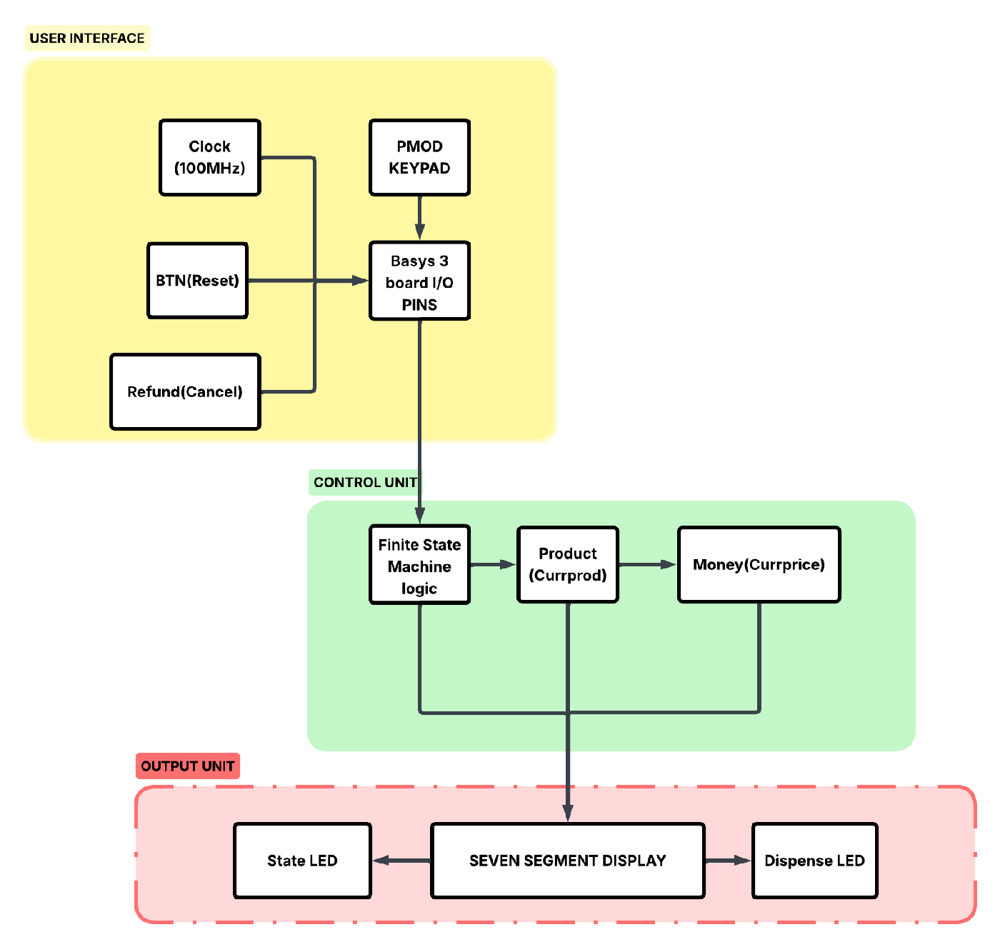
</p>

| Module | File | Function |
|-------|------|----------|
| `top` | [`rtl/top.v`](rtl/top.v) | Top-level wrapper that connects all sub-modules |
| `clock_divider` | [`rtl/clock_divider.v`](rtl/clock_divider.v) | Makes the 1 kHz display clock and the slow keypad/FSM clock from the 100 MHz system clock |
| `Keypad` | [`rtl/Keypad.v`](rtl/Keypad.v) | Scans the PMOD KYPD columns and decodes the pressed key |
| `NSL` | [`rtl/NSL.v`](rtl/NSL.v) | Vending machine FSM: next-state and output logic, prices and stock |
| `sevenseg` | [`rtl/sevenseg.v`](rtl/sevenseg.v) | Multiplexed 7-segment driver with status messages (`buy`, `dis`, `CH`, `rF`, `no`) |

### Finite State Machine

<p align="center">
  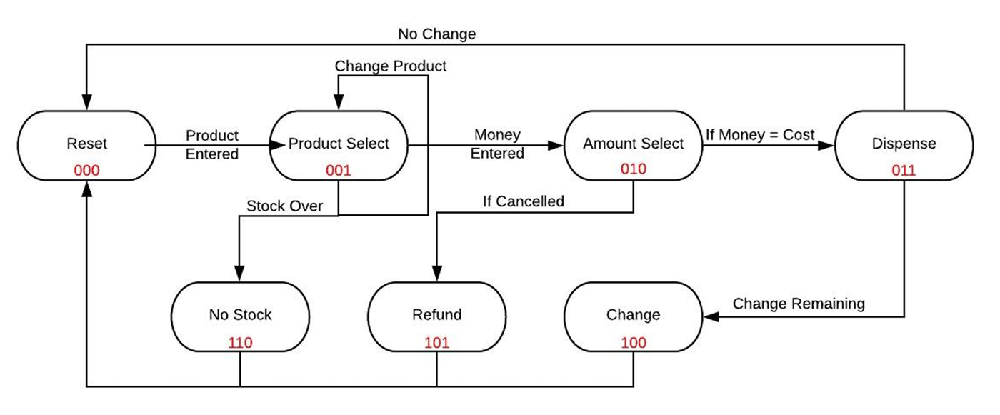
</p>

| Code | State | Description |
|:---:|-------|-------------|
| `000` | Reset | Ready for a new customer; display shows **`buy`** |
| `001` | Product Select | Customer picks A–E; price is shown and stock is checked |
| `010` | Amount Select | Coins are added; remaining balance is shown |
| `011` | Dispense | Money ≥ price; product is dispensed (LD15 lights up) |
| `100` | Change | Extra money is returned and shown on the display |
| `101` | Refund | Cancel pressed; all inserted money is returned |
| `110` | No Stock | Selected product is sold out |

## Hardware Setup

| Item | Details |
|------|---------|
| FPGA board | Digilent Basys3 (XC7A35T-1CPG236C) |
| Input | Digilent PMOD KYPD on header **JA** |
| Keys `A`–`E` | Select a product |
| Keys `1`, `2`, `5` | Insert $1, $2 or $5 |
| Switch SW14 (`btn`) | Finish / return to Reset |
| Switch SW13 (`refnd`) | Cancel and refund |
| LD0–LD2 | Present FSM state |
| LD4–LD7 | Money inserted (binary) |
| LD8–LD11 | Remaining stock of product E |
| LD13–LD14 | Machine ready / heartbeat |
| LD15 | Product dispensed |

Pin mapping: [`constraints/basys3_vending_machine.xdc`](constraints/basys3_vending_machine.xdc)

## Repository Structure

```
fpga-vending-machine-verilog/
├── rtl/                       # Synthesizable Verilog source
│   ├── top.v
│   ├── clock_divider.v
│   ├── Keypad.v
│   ├── NSL.v
│   └── sevenseg.v
├── sim/
│   └── tb_vending_fsm.v       # Self-checking testbench (5 scenarios)
├── constraints/
│   └── basys3_vending_machine.xdc
└── docs/
    └── images/                # Diagrams, waveforms and hardware photos
```

## Getting Started

### Simulation (Icarus Verilog, free)

```bash
iverilog -g2005 -o vend_tb sim/tb_vending_fsm.v rtl/NSL.v
vvp vend_tb
gtkwave vending_fsm.vcd        # optional: view waveforms
```

Expected output:

```
[PASS] Exact payment -> Dispense state (011)
[PASS] Over-payment -> Change state (100)
[PASS] Change returned = $3
[PASS] Cancel -> Refund state (101)
[PASS] Empty product -> No Stock state (110)
...
ALL TESTS PASSED
```

### Running on the FPGA (Xilinx Vivado)

1. Create a new RTL project in Vivado and choose part **xc7a35tcpg236-1** (Basys3).
2. Add all files in `rtl/` as design sources and set `top` as the top module.
3. Add `constraints/basys3_vending_machine.xdc` as the constraints file.
4. Run **Synthesis → Implementation → Generate Bitstream**.
5. Connect the PMOD KYPD to header JA, open **Hardware Manager** and program the board.

## Results

### Simulation Waveforms

| Dispense (011) | Change (100) |
|:---:|:---:|
| 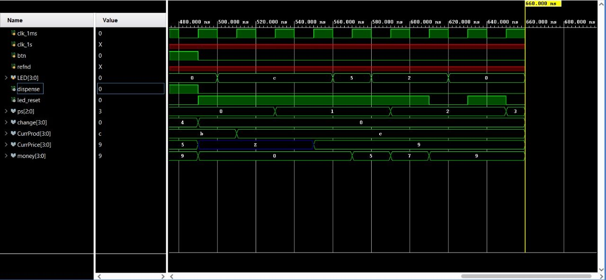 | 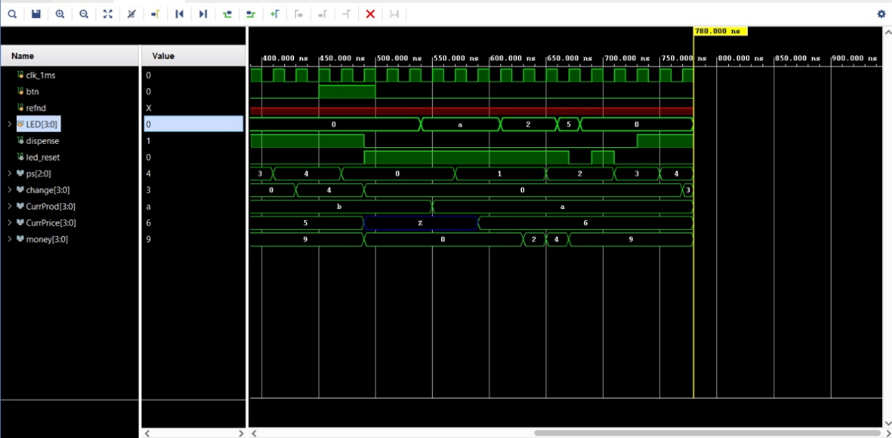 |
| **Refund (101)** | **No Stock (110)** |
| 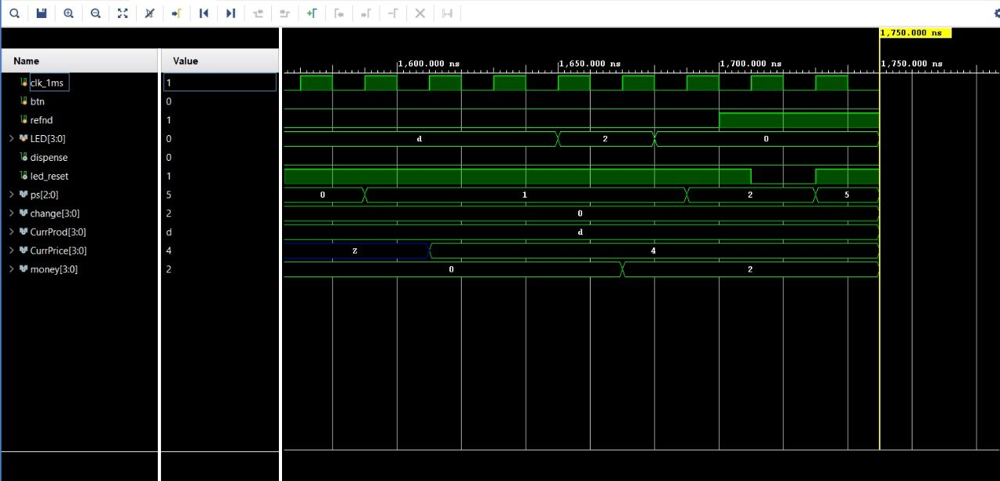 | 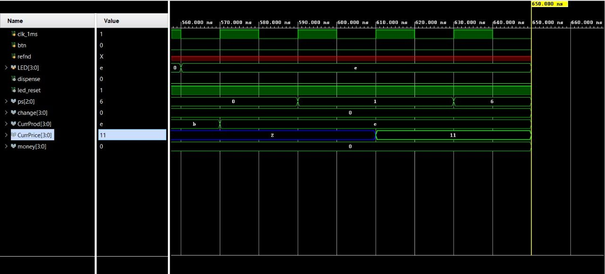 |

### Hardware Demonstration

| Ready to buy | Product A selected ($6) | $5 inserted ($1 left) |
|:---:|:---:|:---:|
| 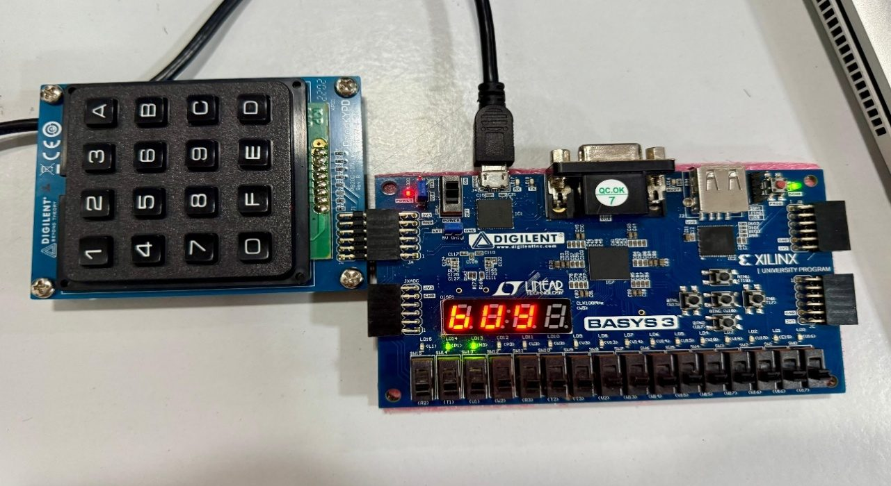 |  | 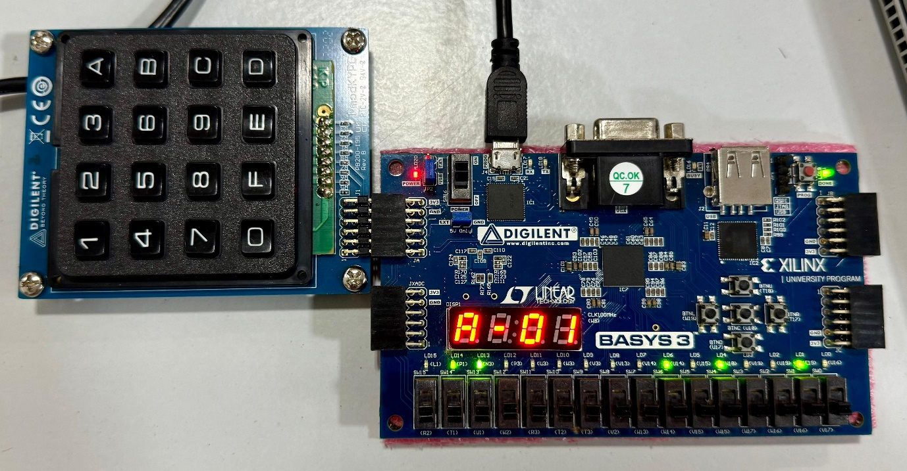 |
| **Product dispensed** | **$1 change returned** | **$2 refunded** |
| 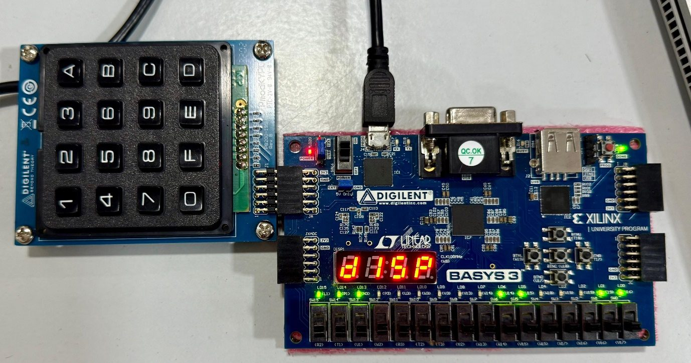 | 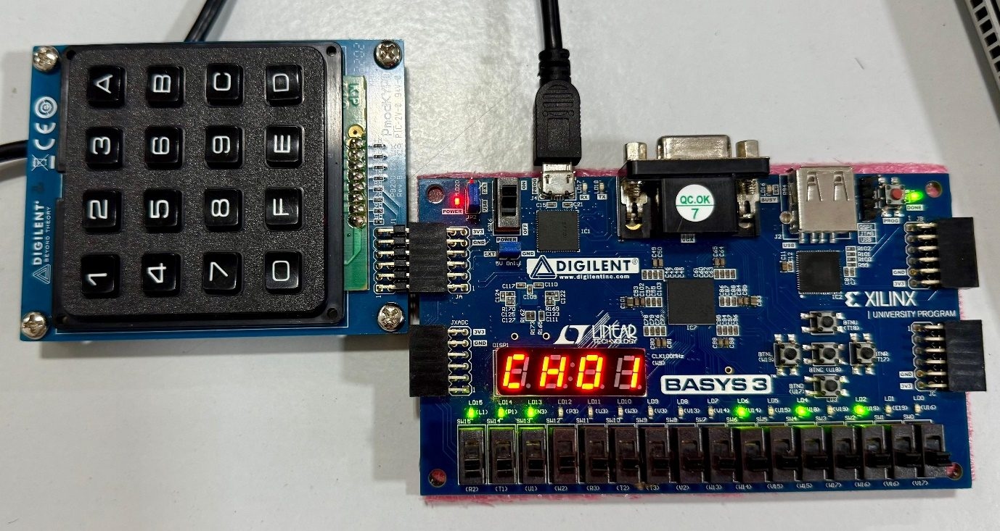 | 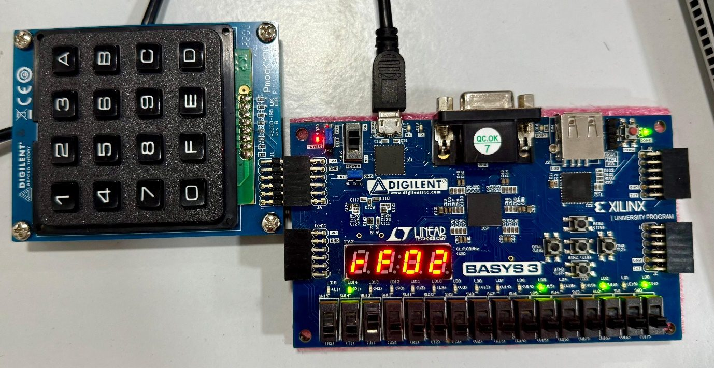 |

### Implementation Summary

| Resource | Used | Available | Utilization |
|---------|-----:|----------:|------------:|
| LUT | 215 | 20,800 | 1.03 % |
| Flip-Flop | 119 | 41,600 | 0.29 % |
| I/O | 37 | 106 | 34.91 % |

<p align="center">
  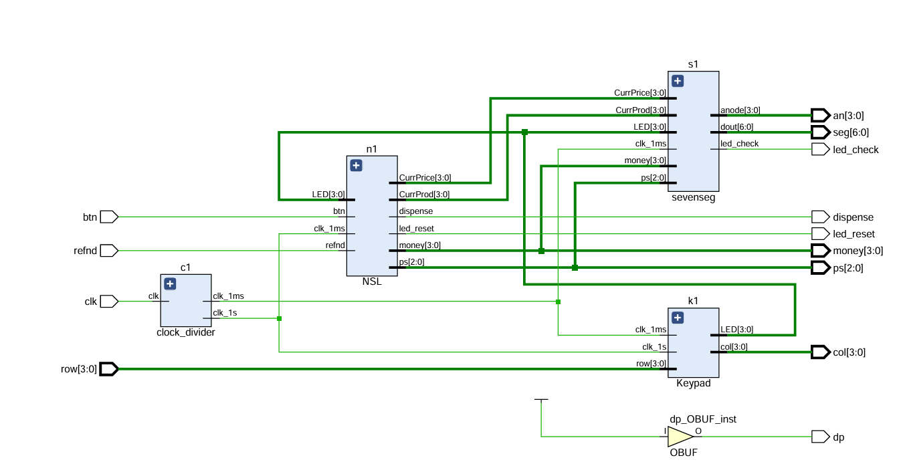
</p>

## Tech Stack

**HDL:** Verilog · **FPGA:** Xilinx Artix-7 (Basys3) · **Tools:** Xilinx Vivado, ModelSim, Icarus Verilog · **Concepts:** FSM design, keypad scanning, display multiplexing, clock division

## Author

**Sujith Krishna P G**

<a href="https://github.com/SujithPG-coder"></a>
<a href="https://www.linkedin.com/in/sujithkrishnapg/"></a>

## License

This project is licensed under the [MIT License](LICENSE).
